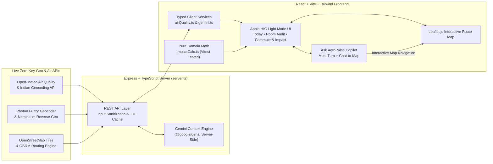

# AeroPulse — Hyperlocal Clean-Air & Low-Emission Action Copilot for India

**AeroPulse** is an Apple HIG Light Mode web application that turns live Pan-India air quality telemetry into immediate, budget-tiered, low-emission daily actions across **Today**, **Room Audit**, and **Commute & Impact** — synchronized in real time with a multi-turn **Ask AeroPulse** Gemini AI copilot.

---

## Problem Statement Alignment

- **100% Live Pan-India Air Quality (Zero Hardcoded AQI):** Every US AQI, PM2.5, PM10, NO₂, O₃, and 24-hour hourly forecast reading is fetched live from the free **Open-Meteo Air Quality API** (with Open-Meteo Geocoding for any Indian city + GPS reverse-geocoding via OpenStreetMap Nominatim).
- **Transparent Data Source & Timestamp:** The top navigation bar continuously surfaces the live data source (`Open-Meteo`) and exact IST sync timestamp with 1-click refresh.
- **Actionable "Why & Impact" Everywhere:** Every recommendation across the **Low-Emission Daily Routine**, **Indoor Air Quality Hacks**, **Gemini Vision Room Audit**, **Smart Commute Comparison**, and **Errand & Trip Bundler** pairs concrete actions with both personal health impact (PM2.5 reduction) and environmental impact (CO₂ avoided).
- **Inclusive & Persona-Calibrated:** Adapts guidance strictly to actual AQI severity across 4 Indian household personas (`Parent with Kids`, `Senior Citizen`, `Office Commuter`, `Student`), risk modifiers (`Asthma`, `Gas Stove`, `Near Main Road`, `No Purifier`), budget tiers (`Free ₹0`, `DIY < ₹1.5k`, `Smart`), and bilingual **English | हिंदी** WhatsApp Colony / RWA alerts.
- **Severe Smog Emergency Protocol (`AQI ≥ 300`):** Automatically activates a collapsible Apple Coral frosted emergency banner with interactive checklist pills and 1-click Family/RWA WhatsApp alert dispatch only when live AQI reaches 300+.

---

## System Architecture



---

## Tech Stack

| Layer | Technologies |
| --- | --- |
| **Frontend** | React 19, TypeScript, Vite, Tailwind CSS v4, Motion (spring animations), Lucide Icons |
| **Maps & Routing** | Leaflet.js, OpenStreetMap tiles (Apple Light Mode filter), Photon fuzzy Indian geocoder, OSRM routing |
| **Live Air Telemetry** | Open-Meteo Air Quality API & Open-Meteo Indian Geocoding API (no API key required) |
| **AI & Vision** | `@google/genai` (strictly server-side via `GEMINI_API_KEY`) — structured JSON for Daily Routine, Room Audit Vision AR pins, and Multi-Turn Global Copilot |
| **Backend** | Express + `tsx` full-stack server with in-memory TTL caching and input sanitization |
| **Testing & Quality** | Vitest unit tests, TypeScript strict checking (`tsc --noEmit`), React Error Boundaries, WCAG AA accessibility |

---

## Setup & Local Development

1. **Install dependencies:**
   ```bash
   npm install
   ```

2. **Configure environment variables:**
   Copy `.env.example` to `.env` and add your server-side Gemini API key:
   ```bash
   cp .env.example .env
   ```
   ```env
   GEMINI_API_KEY="your-gemini-api-key"
   ```
   > **Security Note:** `GEMINI_API_KEY` is read exclusively on the Node.js server (`server.ts`) and is never bundled or exposed to client code. `.env*` files are excluded via `.gitignore`.

3. **Start the development server (port 3000):**
   ```bash
   npm run dev
   ```

4. **Run automated unit tests (Vitest):**
   ```bash
   npm test
   ```

5. **Type-check & build for production:**
   ```bash
   npm run lint
   npm run build
   ```

---

## Quick Evaluation Guide & Sample Inputs

Use the following 3-minute walkthrough to test every capability end-to-end:

1. **Live Pan-India AQI & City Switcher (`Today` Tab):**
   - Switch between **New Delhi**, **Bhubaneswar**, **Mumbai**, **Bengaluru**, **Kolkata**, **Lucknow**, **Hyderabad**, and **Chennai**, or search any Indian city (e.g., `Jaipur`, `Pune`, `Patna`, `Kochi`) in the navbar dropdown.
   - Observe the live **Open-Meteo** AQI, PM2.5, PM10, NO₂, O₃, exact IST sync timestamp, and dynamically computed **24-Hour Visual Smog Clock** best 2-hour Safe Outdoor Window.
   - Toggle personas (`Parent with Kids`, `Senior Citizen`, `Office Commuter`, `Student`) and risk modifiers (`+ Asthma`, `+ Gas Stove`) to regenerate calibrated Gemini routines.
   - If any selected city reaches `AQI ≥ 300`, notice the auto-triggered **Severe Smog Protocol** frosted Coral emergency banner beneath the navbar.

2. **Gemini Vision AR Scanner & Cross-Tab Sync (`Room Audit` Tab):**
   - Click any of the 3 sample room presets (**Balcony Door**, **Gas Kitchen**, **Kids' Study**) or click **Upload Room Photo** to test client-side canvas JPEG compression (`≤ 1024px`, `0.8` quality) + live Gemini Vision structured JSON diagnosis.
   - Click numbered AR hotspot pins on the photo to jump to and highlight their linked Fix Cards, or click a Fix Card to pulse its AR pin.
   - Toggle **Add** on any diagnosed fix and switch back to `Today` → **Indoor Air Quality Hacks** to verify the persisted `From Room Audit` badge.

3. **Smart Commute, Errand Bundler & Colony Ripple (`Commute & Impact` Tab):**
   - Try typing fuzzy Indian landmarks in Origin/Destination (e.g., `Jatani Railway Station` → `Master Canteen`, or `Cyber City` → `Connaught Place`) to test the 350ms debounced Photon frosted autocomplete and live OSRM Leaflet route comparison.
   - Toggle 2–4 chips in the **Errand & Trip Bundler** (`Groceries`, `Pharmacy`, `School Pickup`, `Gym / Bank`) or add a custom stop (e.g., `Tailor`) to see the Clean-Window single-loop suggestion and avoided cold-start CO₂ / PM2.5 math.
   - Toggle **Choice-to-Impact Habit Swaps** and switch between **My Family** and **500 Homes in Colony** to watch the Apple Health concentric rings animate.
   - Toggle **English | हिंदी** in the WhatsApp Colony / RWA alert preview and click **Full Preview** or **Copy WhatsApp Alert**.

4. **Multi-Turn Global Copilot & Chat-to-Map (`Ask AeroPulse`):**
   - Open the bottom-right **Ask AeroPulse** pill and tap any tab-aware starter chip, or try:
     - `"When is the cleanest 2-hour window to take my kids outside today?"`
     - `"Show route from Jatani to Bengaluru on map"` → click the returned **View Route on Map** chip to jump directly into the Leaflet map and auto-plot the route.
   - Switch cities or personas mid-conversation to observe the live **Context Synced** divider inside the chat drawer.
